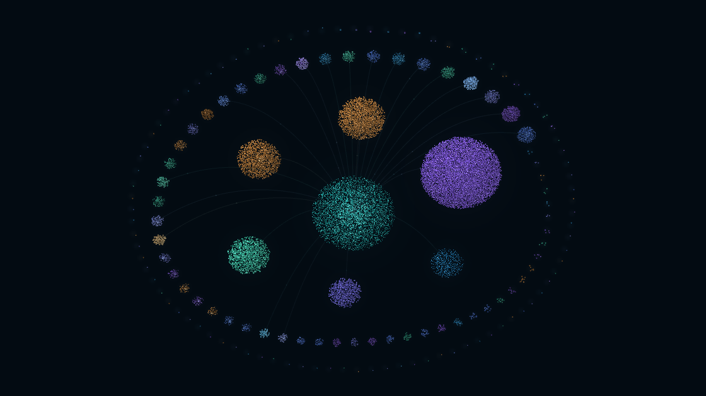

# Gotti — a defensive security monitor I designed and built with AI

*Mind View: Gotti's own memory, drawn in 3D. Each sphere is one part of Gotti and
everything it has seen and decided; the curves are real links between them.*

Gotti is a security monitor for Windows that runs entirely on my own hardware.
It watches the machine in real time, explains what it finds in plain language,
and only ever acts to defend. It never reaches out to other machines.

I designed it and directed the build with AI coding tools. The AI writes code
under rules I set; I decide what gets built, what it's allowed to do, and
whether a result is real.

> **The source code is private on purpose.** This is a security tool. Publishing
> how it detects things would teach an attacker how to get around it. This page
> shows what it does and how I built it, not how it works inside.

## What it does

- **Watches in real time:** processes, network connections, persistence
  (things set to run at startup), and Windows event logs.
- **Explains itself:** every finding is mapped to MITRE ATT&CK and written up in
  plain language: what happened, why it matters, what to check.
- **Defends, never attacks:** any automatic response is logged, can be undone,
  and comes with a reason. I stay in control of anything bigger.
- **Remembers:** a local memory and reasoning core keeps what Gotti has seen and
  decided, so it can connect today's activity to last week's.
- **Stays local:** the AI models run on the laptop's own chips. Nothing is sent
  to a cloud service.

## Results (measured, not guessed)

| Test | Result |
| --- | --- |
| Atomic Red Team live-fire, execution techniques | **6 / 6 caught** |
| Atomic Red Team live-fire, persistence techniques | **2 / 2 caught** |
| Sorting and ranking findings | **~500,000 findings in under 2 seconds** |

Every update runs a full automated test suite before it's installed.

## How I build with AI

1. **Rules come first.** Before any code: it defends only, it never touches
   anything it wasn't told to, and every claim has to be measured.
2. **Scope, then build.** Each change is written up in plain words first: what
   it's for, what it must not break, and how we'll know it worked.
3. **Measure everything.** A feature isn't done because the code compiles. It's
   done when a real test shows it works.
4. **Re-test old wins.** Re-running an attack test that passed weeks earlier
   showed it had quietly stopped working. Most of Gotti's checks had stopped
   running and nobody was alerted. Measuring found it. Now it's fixed and watched.

## Built with

C++20 · CMake · Windows · MITRE ATT&CK · Atomic Red Team · local AI models on
Intel hardware · Three.js (Mind View)

---

Built by **Christian Bennett**, Cybersecurity & Information Assurance student at
WGU and owner of Cloud Computer Service.
